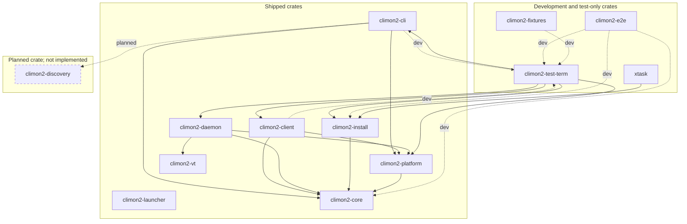

# Workspace crate consumption

This diagram includes every climon2 workspace crate, including test tooling and
`xtask`, but excludes third-party crates. Arrows run from consumer to consumed
crate. Solid arrows are normal Cargo dependencies; dotted arrows labelled
`dev` are dev-dependencies used by tests. Dashed arrows labelled `planned` are
not implemented. Runtime execution and communication are shown separately in
the [artifact diagram](runtime-artifacts.md).

The launcher has no workspace crate dependencies. Cycles through
`climon2-test-term` are test-only: CLI and [client](../GLOSSARY.md#sessions) tests consume the harness,
which consumes their libraries and other runtime libraries.

**Planned:** a separate discovery crate will share session discovery between
the CLI and [monitor](../GLOSSARY.md#sessions), retained in
[Define monitor startup and session discovery](https://github.com/jackgeek/climon2/issues/59).
The monitor will consume discovery continuously and load version-matched client
libraries in-process, with one client thread per [live session](../GLOSSARY.md#sessions). Its crate
placement and the discovery crate's dependencies are not yet specified, so no
additional crate names or edges are implied. Dynamic loading is shown in the
artifact diagram, not as a Cargo dependency. The client library's planned
`cdylib` form is an artifact decision, not a decision to add another crate.
Ratatui is required for monitor rendering; third-party crates are deliberately
excluded from this workspace-only diagram.

The [status/activity revision](session-status.md) also requires the monitor role
to consume `climon2-vt`, keeping one terminal model per session across uncertain
disconnections. Its crate placement remains undecided, so this is not an
invented Cargo edge or a new workspace crate. Daemon-core title detection and
activity/[attention](../GLOSSARY.md#status-and-attention) machines, terminal-signal interpretation, and structured
notification/progress relay do not require a plugin crate; plugin
implementation is deferred. The agreed detection modes and fallback policy
do not assign another workspace crate or change the current dependency edges.
The [agreed terminal contract](protocol/terminal-integration.md) specifies planned
read-only Rust cell/mode/cursor/history views for this monitor reuse. Current
`climon2-vt` remains daemon-only with no public cells; the future monitor
exception does not change current edges or select monitor crate placement.
Exact-release libraries carry terminal bytes, not a native cross-release cell
schema; the monitor parses at effective daemon geometry and paints locally.
Canonical monitor presentation and optional core Focus introduce no new crate.

The platform-neutral encoder and validator for
[daemon wire revision 1](protocol/daemon-client/core-v1.md) lives in
`climon2-core`, which the daemon and client already consume, so it adds no
crate or edge. The agreed revision also
anticipates source-monitor session consumption and browser terminal consumption
over future forwarding boundaries, shown in the artifact diagram. Their crate
placement is unassigned; no new crate or Cargo edge is implied. The wire
specification does not implement these relationships or a native library in a
browser. All workspace crates above remain unchanged.

The [agreed lifecycle](monitor-lifecycle.md), not implemented, specifies
concurrent per-instance shutdown/joins and exponential passive recovery. Selector
Delete reuses Kill and dismisses a row/cache only after definitive termination
and local cleanup. Future headless creation changes only an explicitly headless
session's zero-client lifetime; it does not select another crate or alter a
current Cargo edge. No new crate or consumption arrow is introduced here.

The agreed [operational limits](monitor-operational-limits.md), unimplemented,
require allocation-aware terminal/parser updates and bounded discovery/queues/
thread resources. Monitor reuse of `climon2-vt` must qualify its combining and
auxiliary allocations; the narrow unchanged-engine/infallible-interface
assumptions are reopened, not silently treated as bounded. No replacement
engine, additional workspace crate or dependency edge is selected.

Current edges come from workspace `Cargo.toml` files. This is a consumption
index, not a replacement for the architecture decisions or their permitted
dependency rules.
