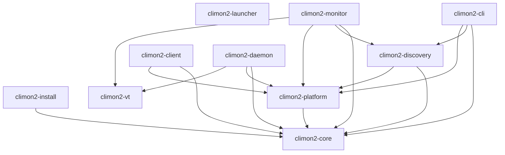
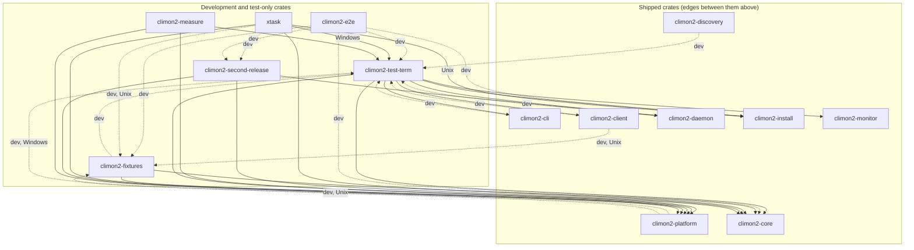

# Workspace crate consumption

Two diagrams cover every climon2 workspace crate, including test tooling and
`xtask`, but exclude third-party crates. Arrows run from consumer to consumed
crate. Solid arrows are normal Cargo dependencies; dotted arrows labelled
`dev` are dev-dependencies used by tests. Runtime execution and communication
are shown separately in the [artifact diagram](runtime-artifacts.md).

## Shipped crates

Only the crates that ship, and the normal dependencies between them.

| Crate | Purpose |
| --- | --- |
| `climon2-launcher` | The `c2` executable, the command users type. It reads the install home's `current` version and hands off to that version's `climon2-cli`. |
| `climon2-cli` | The `climon2-cli` executable behind every `c2` command: `exec`, `attach`, `kill`, `list` and `monitor`. It orchestrates startup and talks to other executables only through their contracts. |
| `climon2-client` | The version-matched, byte-transparent terminal [client](../GLOSSARY.md#sessions) that connects a terminal to one session daemon ([ADR 0001](adr/0001-version-matched-client-and-frozen-hello.md)), and the client library the monitor loads for each session. |
| `climon2-daemon` | The session daemon: it owns one session's PTY and output pump, so clients never own terminal handles. |
| `climon2-install` | Atomic installation of a release payload into a climon2 executable home. |
| `climon2-platform` | The shared platform seams of [ADR 0003](adr/0003-platform-and-shell-seams.md): connections, processes, PTYs, terminals, the runtime directory and logging. |
| `climon2-core` | Platform-neutral session contracts, such as identity, configuration, the hello, metadata and exit status. It parses and applies policy, never performs platform I/O. |
| `climon2-vt` | The virtual terminal of the session daemon and of the monitor's per-session models: a pure, platform-neutral adapter around upstream Alacritty that keeps every engine type private. |
| `climon2-discovery` | Session discovery shared by the CLI, which runs whole passes, and the [monitor](../GLOSSARY.md#sessions), which runs incremental, bounded passes. |
| `climon2-monitor` | The monitor: one terminal that tracks every live session, with the `climon2-monitor` binary that `c2 monitor` starts. |

## Development and test-only crates

Every edge that starts or ends at a development or test-only crate. Shipped
crates appear only where such an edge touches them; the edges between them are
in the diagram above and are not repeated here.

| Crate | Purpose |
| --- | --- |
| `climon2-test-term` | The real-terminal test harness. It runs shipped executables in isolated real terminals at the process boundary and proves which processes the test owns. |
| `climon2-e2e` | Packaged acceptance: it builds and installs a release with the real installer, then drives it in a real terminal. |
| `climon2-fixtures` | Stand-in executables for tests: a terminal program, a full-screen TUI, a CLI, a session daemon, the library host and the client library stand-in. |
| `climon2-second-release` | The test-only [second-release fixture](../GLOSSARY.md#testing): a client library and session daemon built as another release, for cross-release tests. |
| `climon2-measure` | The PERF-01 measurement harness that `cargo xtask measure` runs against an installed candidate archive. |
| `xtask` | Developer automation run as `cargo xtask`: the test and quality gates, mutation and coverage checks, release checks, distribution builds and local installs. |

The shipped crates in this diagram are described under the first diagram.

The launcher has no workspace crate dependencies. Cycles through
`climon2-test-term` are test-only: CLI, discovery, [client](../GLOSSARY.md#sessions)
and daemon tests consume the harness, which consumes their libraries and other
runtime libraries. It consumes `core` directly for the frozen framing of its
raw-socket hello peer.
Linux support adds native bodies inside `climon2-platform`, not another
workspace crate or runtime dependency edge. The test harness consumes those
same Unix seams on Linux and macOS; Linux's ownership exec adapter is a
test-only executable of the existing harness crate. On Windows the harness
builds with `core` alone: its edges to the CLI, client, daemon, installer,
monitor and `platform` are Unix-only until those crates build on Windows. Its
Windows host (#320) is described in
[Windows host and shell qualification](windows-qualification.md#host-models).
On Windows, `platform`'s tests consume the harness too, to host commands in
its pinned ConPTY (#317).

**Current (#74):** the [monitor](../GLOSSARY.md#sessions) is its own shipped
crate, `climon2-monitor`, with a library and the `climon2-monitor` binary. It
consumes `core`, `discovery` (#106), `platform` and `vt` (the only exception to
[ADR 0004](adr/0004-crate-layout-and-dependency-direction.md)'s daemon-only
`climon2-vt` rule: the release baseline, and since #108 each session's model
and its read-only views for painting) and never the CLI, client or daemon
crates.
`climon2-test-term` consumes it only to unify `test-hooks` into the test build.
Ratatui (with `ratatui-core`, enabled for underline colours) is a dependency
of this crate alone; third-party crates are
deliberately excluded from this workspace-only diagram.

**Current (#75):** the [client library](../GLOSSARY.md#sessions)'s `cdylib`,
`libclimon2_client.dylib` on macOS and `libclimon2_client.so` on Linux, is an
artifact of `climon2-client`, not another crate. The `#[repr(C)]` declarations
of its native interface live in `climon2-core`, so the client library, the
client executable and the monitor can share them without new edges; today the
library, the client executable (#100, #101), the monitor (#106), the library
host fixture and xtask's release checks consume them.

**Current (#77):** `climon2-discovery` holds the session discovery that
[Define monitor startup and session discovery](https://github.com/jackgeek/climon2/issues/59)
shares between the CLI and the monitor. It consumes only `core` and
`platform`; the CLI runs whole passes, and the monitor (#106) runs incremental,
bounded passes continuously.

**Current (#84):** the one validated loader for client libraries lives in
`climon2-platform`, as [ADR 0004](adr/0004-crate-layout-and-dependency-direction.md)
records. The monitor (#106), the library-host fixture, xtask release checks
and the client executable, for attach and kill (#100, #101), use it. Test-only
loader fixtures consume the platform crate as dev-dependencies, and the
client's tests consume `climon2-fixtures` for the client library stand-in.

**Current (#155):** the CLI, the client executable and the monitor share
their start-up and failure rules instead of copying them; no edge changes.
They return `climon2-core`'s `failure::Failure` and find the climon2 home and
their install layout through `climon2-platform`'s `home` module.

**Current (#97):** `climon2-second-release` is the test-only
[second-release fixture](../GLOSSARY.md#testing). Its library compiles
`climon2-client`'s library source as a package of its own version, so it
consumes what that source consumes, `core` and `platform`, and not
`climon2-client` itself. Its daemon binary runs the `climon2-daemon` library
behind a thin main with that version compiled in. `climon2-e2e` and `xtask`
consume the package as dev-dependencies only so that Cargo builds its
`cdylib`; no code links it. The developer accepted this package on
2026-11-15 ([decision on #97](https://github.com/jackgeek/climon2/issues/97#issuecomment-6892644920); [ADR 0004](adr/0004-crate-layout-and-dependency-direction.md)).

**Current (#319):** `xtask` consumes `core` and `platform` on every platform.
Its edge to `install` and its `dev` edge to `climon2-fixtures`, whose
stand-ins are Unix programs, are Unix-only: the release checks and installs
need the Unix installer. Its edge to `climon2-test-term` is Windows-only:
Windows `cargo xtask dist` takes the pinned ConPTY files from the harness,
which fetches and verifies them for its own Windows host, so one piece of
code reads the pin. On Windows that edge brings no product crates, because
the harness builds there with `core` alone. From #314 until #319, `xtask`
built on Windows without any workspace crate, for the source check and the
Windows [quality gate](windows-quality.md) only.

**Current (#316):** `climon2-cli`'s edge to `discovery` and its `dev` edge to
`climon2-test-term` hold on every platform; until #316 they were Unix-only.
On Windows the CLI answers help, version and usage errors and runs `list`,
whose discovery now builds there; every other subcommand fails until its
Windows seams exist. Its list tests drive the CLI in the harness's Windows
host. The launcher still has no dependencies on Windows: it declares the few
Windows calls it makes itself.

**Current (#318):** `climon2-client` builds on Windows, with its edges to
`core` and `platform` and its `dev` edge to `climon2-test-term`: its library
is `climon2_client.dll`, and its executable runs kill mode there. Its `dev`
edge to `climon2-fixtures`, whose stand-ins are Unix programs, is Unix-only,
as `platform`'s already was. The Windows loader, notifier and native path
encoding are bodies inside `climon2-platform`'s seams, not another crate or
edge.

**Current (#321):** the edges are unchanged. On Windows the CLI also runs
`exec` and `attach`, and the client attaches; its console handling, the
Windows wait and the CLI's spawn-and-wait hand-off are bodies inside
`climon2-platform`'s seams. The CLI's Windows smoke test drives the packaged
product in the harness's Windows host through its existing `dev` edge to
`climon2-test-term`.

**Current (#121):** `climon2-measure` is the test-only PERF-01 measurement
harness that `cargo xtask measure` runs (by Cargo, not as a dependency, so
`xtask` gains no edge). It consumes `core` for session metadata,
`platform`'s shared loader to read the candidate library's embedded
requirements, and `climon2-test-term`'s emulated host terminals; it measures
an installed candidate archive's executables and never links them.

**Current (#106):** the monitor loads version-matched client libraries
in-process through the shared loader, with one owner thread per
[live session](../GLOSSARY.md#sessions)'s passive client. Dynamic loading is
shown in the artifact diagram, not as a Cargo dependency.

The [status/activity revision](session-status.md) also requires the monitor
to keep one `climon2-vt` terminal model per session across uncertain
disconnections, through its existing `vt` edge, which it does (#108, #116).
Daemon-core title detection and
activity/[attention](../GLOSSARY.md#status-and-attention) machines, terminal-signal interpretation, and structured
notification/progress relay do not require a plugin crate; plugin
implementation is deferred. The agreed detection modes and fallback policy
do not assign another workspace crate or change the current dependency edges.
The [agreed terminal contract](protocol/terminal-integration.md) has the monitor
paint read-only Rust cell, cursor, mode and history views of these models, which
`climon2-vt` provides (#83) without exposing engine types; the monitor paints
from them (#108), and also uses the crate for the documented
normal-shell baseline and, at startup, the `Model`'s mandatory allocation, to
check that its limits hold one session's terminal model (#167).
Exact-release libraries carry terminal bytes, not a native cross-release cell
schema; the monitor parses at effective daemon geometry and paints locally.
Canonical monitor presentation and optional core Focus introduce no new crate.

The platform-neutral encoder and validator for
[daemon wire revision 1](protocol/daemon-client/core-v1.md) lives in
`climon2-core`, which the daemon and client already consume, so it adds no
crate or edge. Beside it, core's `protocol` module now holds only the frozen
hello; retiring the version-private post-hello message set
([#104](https://github.com/jackgeek/climon2/issues/104)) removed no crate or
edge either. The agreed revision also
anticipates source-monitor session consumption and browser terminal consumption
over future forwarding boundaries, shown in the artifact diagram. Their crate
placement is unassigned; no new crate or Cargo edge is implied. The wire
specification does not implement these relationships or a native library in a
browser. All workspace crates above remain unchanged.

The [agreed lifecycle](monitor-lifecycle.md) specifies
concurrent per-instance shutdown/joins (implemented by #118) and exponential
passive recovery (implemented by #116). Selector
Delete reuses Kill and dismisses a row/cache only after definitive termination
and local cleanup (implemented by #117). Implemented headless creation changes only an explicitly
headless session's zero-client lifetime. Its policy type lives in
`climon2-core`, which the CLI and daemon already consume; it does not select
another crate or alter a current Cargo edge. No new crate or consumption arrow
is introduced here.

The agreed [operational limits](monitor-operational-limits.md), implemented
as far as their status says (#119, #120), require allocation-aware terminal/parser updates and bounded discovery/queues/
thread resources. Monitor reuse of `climon2-vt` must qualify its combining and
auxiliary allocations; the narrow unchanged-engine/infallible-interface
assumptions are reopened, not silently treated as bounded. `climon2-vt`'s
allocation-bounded `Model` (#76, ADR 0007), with one `Parser` shared per
monitor (#166), qualifies them on the unchanged engine; the monitor keeps one
per session (#108) and checks their mandatory allocation at startup (#167). No replacement
engine, additional workspace crate or dependency edge is selected.

Current edges come from workspace `Cargo.toml` files. This is a consumption
index, not a replacement for the architecture decisions or their permitted
dependency rules.
