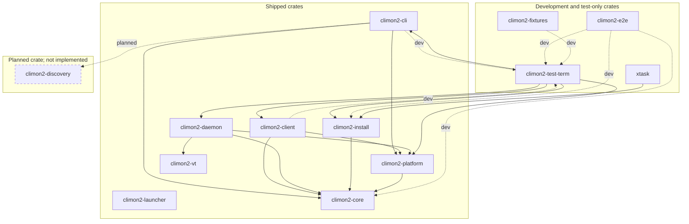

# Workspace crate consumption

This diagram includes every climon2 workspace crate, including test tooling and
`xtask`, but excludes third-party crates. Arrows run from consumer to consumed
crate. Solid arrows are normal Cargo dependencies; dotted arrows labelled
`dev` are dev-dependencies used by tests. Dashed arrows labelled `planned` are
not implemented. Runtime execution and communication are shown separately in
the [artifact diagram](runtime-artifacts.md).

The launcher has no workspace crate dependencies. Cycles through
`climon2-test-term` are test-only: CLI and client tests consume the harness,
which consumes their libraries and other runtime libraries.

**Planned:** a separate discovery crate will share session discovery between
the CLI and monitor, as resolved in
[Define monitor startup and session discovery](https://github.com/jackgeek/climon2/issues/59).
The monitor's crate placement and the discovery crate's dependencies are not
yet specified, so no additional crate names or edges are implied. The client
library's planned `cdylib` form is an artifact decision, not a decision to add
another crate.

Current edges come from workspace `Cargo.toml` files. This is a consumption
index, not a replacement for the architecture decisions or their permitted
dependency rules.
