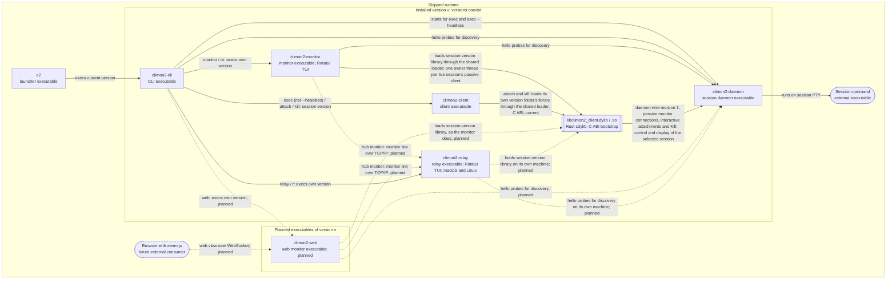
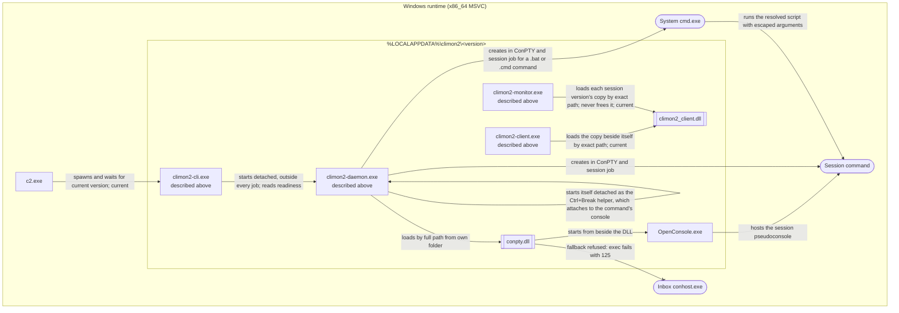

# Executables and dynamic libraries

This diagram covers the climon2 executables and dynamic libraries that run when
a user types `c2` followed by a command, and the artifacts those calls
ultimately invoke. It omits installation (the installer and install arrows)
and development or test-only executables: `xtask`, Cargo tooling, fixtures,
test harnesses, and stand-in or second-release libraries. Arrows run from
consumer to consumed artifact;
labels distinguish execution, communication, and loading.
Solid relationships exist today; dashed relationships are planned.
The current executable relationships apply on macOS and x86_64 GNU/Linux;
native archives are described in [distribution](../distribution.md).
The development host owns shared/Linux CRAP and mutation; CI qualifies only
macOS-exclusive source, while retaining native runtime/archive tests. This
[quality split](../distribution.md#release-gates) changes no artifact or
consumption relationship.

`v` represents a [session](../../../GLOSSARY.md#sessions)'s installed version, not necessarily the current
version selected by the launcher. The CLI starts a new session using its own
version; [attachment](../../../GLOSSARY.md#attachment-and-control) and termination use the existing session's version.
The launcher is installed as `c2`, the only command name (#303); there is no
`climon2` command.
The installer is a release-payload executable, not a `c2 install` command.
Installation relationships are outside this consumption diagram.

## Windows

This diagram shows only what Windows changes in the diagram above: how the
launcher reaches the CLI, how the CLI starts the daemon, how the daemon
reaches the session command through ConPTY, the Windows pseudoconsole, and
through `cmd.exe` when the command is a batch file, how the daemon starts its
own executable again as the Ctrl+Break helper, and how the client and the
monitor load the client library. How the CLI starts the
client and the monitor is omitted. Arrows run from consumer to
consumed artifact. Solid arrows exist: the launcher reaching the CLI
([#315](https://github.com/jackgeek/climon2/issues/315)), the CLI starting
the daemon, which hosts the session's command in the bundled ConPTY
([#317](https://github.com/jackgeek/climon2/issues/317)) and runs a batch file
through the system's `cmd.exe`
([#322](https://github.com/jackgeek/climon2/issues/322)) and starts itself as
the Ctrl+Break helper ([#326](https://github.com/jackgeek/climon2/issues/326)),
and the client loading
the library beside it to end a session for `c2 kill`
([#318](https://github.com/jackgeek/climon2/issues/318)) and to attach for
`c2 exec` and `c2 attach` ([#321](https://github.com/jackgeek/climon2/issues/321)), and the monitor
loading each session version's library
([#327](https://github.com/jackgeek/climon2/issues/327)). No arrow is planned
any more. How each process starts is in the
[Windows platform and lifecycle contract](../windows/lifecycle.md). The decisions are in
[ADR 0003](../../adr/0003-platform-and-shell-seams.md#windows-io-and-transport)
and, for the library,
[#216](https://github.com/jackgeek/climon2/issues/216).

| Node | Purpose |
|---|---|
| `c2.exe` | The frozen launcher, the only command name. Windows cannot replace a process, so it starts the CLI and waits for it. |
| `climon2-cli.exe`, `climon2-daemon.exe`, `climon2-client.exe`, `climon2-monitor.exe` | The same roles as on Unix. `climon2-cli.exe` runs `list`, `exec`, `attach` and `kill`; for `exec` without `--headless`, `attach` and `kill` it starts the session version's `climon2-client.exe` and waits for it. For `monitor` it starts its own version's `climon2-monitor.exe` and waits for it. `climon2-daemon.exe` also runs as the short-lived Ctrl+Break helper, which it starts with `--break-console`. |
| `climon2_client.dll` | The client library, the Windows build of the Rust cdylib above. It links the C runtime statically, as every Windows build does, imports only Windows system DLLs and exports only its bootstrap symbol. The loader never frees it and refuses it when Windows loaded another file for its path. |
| `conpty.dll` | Microsoft's pinned ConPTY library, shipped in each version folder. Only the daemon loads it. |
| `OpenConsole.exe` | The console host that `conpty.dll` starts for each session, from the same pinned package. |
| Session command | The program the session runs, found through `PATH` and `PATHEXT` by the daemon, never in the current directory. It sees its first argument as typed. |
| System `cmd.exe` | Windows' command processor from the system folder. The daemon starts it with `/e:ON /v:OFF /d /c` to run a session command that is a `.bat` or `.cmd` file. |
| Inbox `conhost.exe` | Windows' own console host. It is never used: if `OpenConsole.exe` is missing, `conpty.dll` would fall back to it, so the daemon checks both files and `exec` fails with 125. |

**Current (#322):** the daemon resolves the session's command itself and
starts it by its resolved path. A `.bat` or `.cmd` command runs through the
system's `cmd.exe`, which is not part of the release
([Windows platform and lifecycle contract](../windows/lifecycle.md#command-resolution-and-arguments)).

**Current (#319, #329, #327):** the Windows release zip carries `c2.exe`,
`install.exe` and, in its version folder, `climon2-cli.exe`,
`climon2-daemon.exe`, `climon2-client.exe`, `climon2-monitor.exe`,
`climon2_client.dll`, `conpty.dll` and `OpenConsole.exe`.
`cargo xtask dist` checks that each file is x86-64 code of its kind and that
none imports the Visual C++ runtime
([Windows packaging](../windows/distribution.md#how-it-is-built)). The download
script `install.ps1` is published beside the zip. Both installation routes end
in `install.exe`, which copies the release into the executable home, replaces
`c2.exe` when it can and writes `current`. As on Unix, installation is outside
this consumption diagram, so packaging and installing add no relationship to
it.

**Current (#323):** closing the host, losing the last client and `c2 kill`
add no artifact or relationship. `climon2-client.exe` now exits with the
session's status at its full 32 bits, so after `c2 kill` an attached client,
the CLI waiting for it and `c2.exe` all exit with the command's close status,
such as `0xC000013A`
([Windows platform and lifecycle contract](../windows/lifecycle.md#session-job-and-hang-up)).

For workspace crate consumption, see the [crate diagram](crate-relationships.md).

`climon2-test-term` builds `climon2-test-owned` as test tooling on Linux and
macOS, never as a release payload. It opens one test-owned file descriptor
before execing the requested terminal root. Forked descendants inherit that
descriptor across environment clearing, new sessions and reparenting, so leak
checks (procfs on Linux, `libproc` on macOS) do not depend on a sample catching
short-lived parents. Process identity, sampled ancestry (macOS kernel
process/image ids), session membership and environment markers remain
additional ownership evidence. Commands that explicitly close inherited
descriptors keep only that additional evidence. The daemon is one: it keeps
only stdio and the pipe on which it tells its starter it is ready. On macOS a
descriptor gets close-on-exec only after it is made, so without this a
descriptor that another thread of the starter was making could live as long
as the daemon ([#158](https://github.com/jackgeek/climon2/issues/158)).

**Current (#121):** `climon2-measure` is test tooling, never a release
payload. `cargo xtask measure` runs it on an exact candidate archive: it
installs the archive with that archive's own installer, starts the measured
sessions through the installed `climon2` with itself (its `workload` command)
as their session command, measures the installed monitor against one
installed `c2 attach` per session on emulated host terminals, and loads
the candidate library through the shared loader only to read its embedded
requirements. The [measurement workflow](../../../.github/workflows/measure.yml)
runs it on release candidates and on manual dispatch.

**Current (#122):** `cargo xtask qualify` is release tooling, never a
release payload. `qualify run` runs the packaged tests against an exact
candidate archive and every workspace test through Cargo, reads the
measurement job's reports and the owner's records in `qualification/`, and
writes one platform's [evidence records](../../../GLOSSARY.md#testing);
`qualify verdict` judges every platform's records with the owner's
dispositions. The [Release workflow](../../../.github/workflows/release.yml)
publishes the records as workflow artifacts and as the release asset
`climon2-<version>-qualification.tar.gz`, beside the archives, install script
and `SHA256SUMS`; that asset is evidence, not something the installer reads.

**Current (#75, #85, #93, #94):** every release builds and ships the client library in
its version folder: `libclimon2_client.dylib` (universal arm64/x86_64) on macOS
and `libclimon2_client.so` on x86-64 GNU/Linux, both from one Rust cdylib
artifact of `climon2-client`. Each exports only the frozen
`climon2_client_get_interface` bootstrap and implements the bootstrap,
description and local instance lifecycle of
[native revision 1](../protocol/monitor-client/README.md), and its instances
open passive monitor connections or interactive attachments to session
daemons over [daemon wire revision 1](../protocol/daemon-client/README.md) and
relay control and display (#94). The library host fixture drives those instances
through the function table, with the test-hooks library's fault injection,
as the Library layer's instrumented host. It also serves a clearly labelled
fake daemon peer that the library under test connects to, and probes real
session daemons' hello state. On x86-64 GNU/Linux the host exports glibc's
allocation entry points, which the loaded library binds to, so it can count
the library's heap independently of the library's own allocation accounting
(#180). The `climon2-client` crate's `#[global_allocator]`, which measures
that accounting, replaces the allocator of every artifact that links the
crate: the client library, the client executable and the package's own test
binaries ([ADR 0004](../../adr/0004-crate-layout-and-dependency-direction.md)). The
Linux library links the GCC
unwinder statically, because no unwinding leaves it, so it needs only glibc's
libraries and has no soname, RPATH or RUNPATH, as the
[Linux decision](https://github.com/jackgeek/climon2/issues/125) requires for
release isolation; release checks enforce each rule. The monitor loads it
(#106), the client executable loads it for ordinary attach (#101) and kill
mode (#100), and test tooling loads it: the library host fixture, xtask's
release checks and `climon2-measure` (#121). Cargo's ordinary
`lib` targets, including `climon2-core`, `climon2-platform`,
`climon2-discovery` and `climon2-vt`, are not separately loaded dynamic
libraries; the CLI's and the monitor's hello probes for discovery come from
`climon2-discovery` linked into each executable. System and third-party libraries
and individual generated test harness names are outside this artifact inventory.

**Current (#106):** the [monitor](../../../GLOSSARY.md#sessions) loads
version-matched [client libraries](../../../GLOSSARY.md#sessions) directly into its
own process through the shared loader, one load per release on a worker
thread, sharing it for every session on that release. Each live session's
passive client has its own owner thread. Clients start eagerly, newest created
first, with bounded concurrent starts; continuous discovery adds clients for
new sessions, and background clients never take control. Native client crashes
can terminate the entire monitor. Ratatui draws the permanent top row, the
body and the basic [selector](../../../GLOSSARY.md#attachment-and-control).

**Current (#108):** Enter acquires the selected session through its client,
which relays its control, restorations and display. The monitor parses them
into its own allocation-bounded `climon2-vt` model per session and paints the
selected one from `climon2-vt`'s read-only views, below the top row at the
session's effective geometry; it submits Ready and Resize through the client.
Session bytes never go directly to the host, and the daemon alone answers
session queries.

**Planned:** background clients relay negotiated plugin data.

**Current (#108 to #116):** the
[agreed terminal contract](../protocol/terminal-integration.md), implemented
by the monitor, selects exact ordered terminal
bytes/control/restoration through existing in-process record queues and
monitor-owned `climon2-vt` models, with read-only Rust views for Ratatui.
Monitor-mode daemon presentation uses
effective session geometry, not host/requested dimensions, including background
[promotion](../../../GLOSSARY.md#attachment-and-control); session daemons already
serialize it so. Optional core Focus is not
a plugin/artifact addition. No new dynamic library is chosen by this amendment.

The [status/activity revision](../behaviour/session-status.md) puts title detection and both
state machines and terminal-signal interpretation in
[daemon](../../../GLOSSARY.md#sessions) core, not plugins.
The client library carries core title/status reports, structured notification/
progress metadata, and explicit [viewing](../../../GLOSSARY.md#status-and-attention) information. Metadata is available
without control, not raw [OSC](../protocol/TERMS.md#osc) passthrough to host terminals. Root program status
and shell lifecycle choose explicit detection or heuristic fallback.
Plugin implementation, configuration, and interface examples are deferred; the earlier title-plugin
release prerequisite is superseded. No new plugin executable or dynamic library
is specified. The session daemon (#91, #92, #98), the client library (#95,
#98) and the monitor (#107, #114, #115) implement these mechanics; only
plugins remain deferred.

The monitor retains a `climon2-vt` model per session for disconnected terminal/
scrollback inspection and reconnects passively without automatic takeover.
Known completion stops retries. These relationships do not introduce a session
survival guarantee or a persisted archive of completed sessions.
The [agreed lifecycle](../behaviour/monitor/lifecycle.md), implemented by #116 to #118, adds exponential
passive recovery, read-only disconnected history with a `Reconnecting...` overlay,
and coordinated concurrent shutdown. Local instance cleanup and joins precede
run-local selector dismissal; stalled cleanup ends the whole monitor process,
never an individual thread or loaded library. Connected revoked sessions show
their placeholder, not cached history. Selector Delete uses the existing Kill
semantics and adds confirmed termination/removal, not another runtime artifact.

The agreed [operational limits](../behaviour/monitor/operational-limits.md), implemented as
far as their status says (#119, #120), bound admission, queues, client threads/workers/descriptors and retained shared
release resources. Resource-blocked rows remain visible; history pressure
preserves a recent page. Unsafe growth/cleanup is explicit failure, not client
eviction or unloading. Allocation-aware terminal qualification reopens the
narrow unbounded-engine assumption; `climon2-vt`'s allocation-bounded `Model`
(#76), fed through one `Parser` shared per monitor (#166), provides it for
the monitor's per-session models (#108); at startup the monitor also reads
their mandatory allocation and the parser's size, to check that its limits
hold one session's model beside the parser (#167). It chooses no new executable/library or consumption arrow, and does
not sandbox trusted native code.

**Current (#100, #101, #102):** for ordinary attach and in kill mode the
client executable loads the library in its own version folder,
`<executable home>/<version>/`, through the shared loader, whatever
`current`, the working directory or search paths name, and drives one
instance through the C ABI: an interactive Open and the bridge's Input,
Resize, Acquire, Ready, Set viewing, Acknowledge and Leave for attach, or
one Kill; the library speaks
daemon wire revision 1 to the session daemon. The library instance writes
its diagnostics to a log file of its own in the session-log directory,
beside the client's,
`<climon2 home>/logs/<session-id>/library-<UTC second>-<pid>.log`, since
spec #73 places each instance's library log in its session's log. A missing,
other-release or faulty library fails before any connection. Session
daemons speak only the frozen hello and daemon wire revision 1: the
version-private post-hello protocol is retired
([#104](https://github.com/jackgeek/climon2/issues/104)), so no artifact
consumes it.

**Current (#84):** one validated loader for client libraries is part of
`climon2-platform`, not a separate artifact; the monitor (#106) and the client
executable (#100, #101) load through it. The library host and xtask's release
checks load the client library through it too, from a version folder of an
executable home. The [client library stand-in](../../../GLOSSARY.md#testing),
`crates/climon2-fixtures/stand-in/client-library.c`, is compiled by tests,
through `climon2_fixtures::stand_in`, into a test-only library, exact or with
one defect: xtask's release-check tests
load it through the same release checks as the real library, and
`climon2-platform`'s loader tests load it, as the faulty library, through the
loader. The client executable's tests put it beside the executable as the
faulty library, and, with its `RECORD_STARTUP` probe, to record the limits
the executable passes (#101). It is never shipped.

**Current (#97):** the [second-release fixture](../../../GLOSSARY.md#testing) is
two test-only artifacts of the `climon2-second-release` crate, both release
0.0.97: its library, the `cdylib` of `climon2-client`'s library source built
without test hooks, which Cargo leaves in `deps/`; and its session daemon,
`climon2-second-release-daemon`, the `climon2-daemon` library behind a thin
main that serves only 0.0.97 and gives its session's command
`CLIMON2_SECOND_RELEASE_DAEMON`. The mixed-release Library-layer tests package
both with this build's other executables as a 0.0.97 release and install it
with the real installer in a sibling version folder, so that folder's CLI
starts 0.0.97 sessions served by the fixture's daemon, and its client
executable, this build's, kills them through that folder's 0.0.97 library
(#100). One library host loads
both releases' libraries through the shared loader, and each release's
instances open passive monitor connections to their own release's daemons.
xtask's tests run the release checks on the library as 0.0.97's. The
packaged controlled-versions test runs this build's client executable from a
0.0.97 folder beside that library, so that it attaches to a 0.0.97 session
(#101). Neither is ever shipped. The developer accepted this fixture on 2026-11-15
([decision on #97](https://github.com/jackgeek/climon2/issues/97#issuecomment-6892644920); [ADR 0004](../../adr/0004-crate-layout-and-dependency-direction.md)).

**Current (#74):** every version folder ships the `climon2-monitor` executable,
on macOS and x86-64 GNU/Linux. `c2 monitor` and `c2 m` reach it through
the launcher and the current version's CLI, which
execs its own version's monitor exactly as it execs a version-matched client,
so the monitor is always the current version. That handoff between executables
of one release is not frozen. Since #106 it discovers sessions and loads their
libraries.

**Current (#490):** the `climon2-monitor` executable is built from the
monitor's terminal interface package, `climon2-monitor-tui`, which links the
[monitor library](../../../GLOSSARY.md#sessions) (`climon2-monitor`) statically
as an ordinary Rust crate. The executable, its name, its place in the version
folder and every arrow above are unchanged; no dynamic library is added
([ADR 0011](../../adr/0011-monitor-library-and-client-embedding.md)).

The agreed [embedding design](../protocol/library-embedding.md) loads
`<executable home>/<session version>/libclimon2_client.dylib` on macOS, or
`libclimon2_client.so` on x86-64 GNU/Linux, with no release fallback. It uses a versioned C interface, per-instance client threads,
release-private dependency resolution, and explicit memory ownership.
Every successfully opened library handle stays loaded until monitor exit,
including handles rejected by later validation. Such releases remain in use
until process exit; completed instance cleanup and joins do not unload them.
The monitor's loading is current (#106), as is the client executable's for attach and kill (#100, #101). Complete interface
declarations are specified in [native revision 1](../protocol/monitor-client/README.md),
with explicit startup/role, ownership, cleanup and fresh-instance recovery calls.
No new artifact or consumption arrow is added. Monitor-client communication is
agreed and implemented by the client library (#85 to #98) and the monitor
(#106 to #120).
[Daemon wire revision 1](../protocol/daemon-client/README.md) is agreed and
implemented: session daemons serve
[passive monitor connections](../../../GLOSSARY.md#attachment-and-control),
interactive [attachments](../../../GLOSSARY.md#attachment-and-control) and
standalone [Kill](../../../GLOSSARY.md#attachment-and-control) over it, with the
command's final result, and passive monitor connections that acquire or
inherit control with
[canonical presentation](../../../GLOSSARY.md#restoration-and-presentation), and
it is the only protocol they speak after hello. The client library consumes
it, as the diagram shows, and the monitor consumes it through that library
(#106).

The wire core is independent of the current private Unix socket carrier.
A [relay](../../../GLOSSARY.md#monitor-links) serves one machine's sessions to a
[hub monitor](../../../GLOSSARY.md#monitor-links) on another over a
[monitor link](../../../GLOSSARY.md#monitor-links) carried by
[TCP/IP](../protocol/TERMS.md#tcpip). The relay is an ordinary client of its
own machine's session daemons, so daemon wire revision 1 never crosses a
machine boundary
([ADR 0009](../../adr/0009-relay-terminates-daemon-wire.md)). The
[web monitor](../../../GLOSSARY.md#web-monitor) is a monitor without a
terminal interface that serves a web view to browsers over
[WebSocket](../protocol/TERMS.md#websocket), where xterm.js shows session
content. The monitor and the web monitor are built on one monitor library, an
ordinary Rust crate linked into each, so it adds no dynamic library; the
monitor already is (#490). The
relay shares only the code that runs client library instances
([ADR 0011](../../adr/0011-monitor-library-and-client-embedding.md)). The
relay's executable and the monitor's are drawn in one version folder, as
each machine's install has both, although a hub monitor links to a relay
running on another machine, from that machine's own install.
Dashed arrows above point from consumer to provider, not in the direction
[bytes](../protocol/TERMS.md#byte) happen to flow.
No native client library is assumed inside a browser. Browser authentication
and transport security remain unresolved;
same-[UID](../protocol/TERMS.md#uid)/private-directory local checks do not define
them. No implementation of a web monitor is claimed.

**Current (#499):** every version folder on macOS and x86-64 GNU/Linux ships
the `climon2-relay` executable. `c2 relay` and `c2 r` reach it through the
launcher and the current version's CLI, which execs its own version's relay
with the arguments it was given, as it execs the monitor. The relay binds its
TCP listener, shows its own screen and stops; it does not yet probe daemons,
load the client library or accept a monitor link, so those arrows stay
dashed. The Windows release does not ship it: monitor links are specified for
macOS and Linux only, and a Windows build of `climon2-relay` refuses to
start.

`c2 exec --headless` returns after daemon-confirmed creation without
starting an interactive client: the CLI starts the daemon, passing the headless
policy as a private startup argument, and never execs the client. A
[headless session](../../../GLOSSARY.md#sessions) keeps its explicit zero-client
survival policy throughout its lifetime, including after later clients
unexpectedly leave; command completion or existing CLI Kill ends it. The
[lifecycle decision](../behaviour/monitor/lifecycle.md) agrees this narrow exception, not
universal persistence or a new executable/library. It is implemented and adds no
artifact or relationship; only the CLI's labels above name it.

The planned relationships are indexed by
[Chart the interactive monitor specification](https://github.com/jackgeek/climon2/issues/57);
the hosting and control decision lives in
[Define monitor client ownership and control](https://github.com/jackgeek/climon2/issues/58).
The diagram is a relationship index, not a second interface specification.
