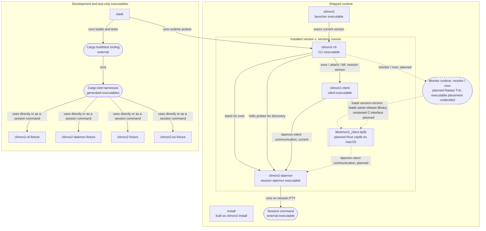

# Executables and dynamic libraries

This diagram covers every climon2-owned executable target and dynamic library,
including development fixtures. Arrows run from consumer to consumed artifact;
labels distinguish execution, communication, and loading.
Solid relationships exist today; dashed relationships are planned.

`v` represents a session's installed version, not necessarily the current
version selected by the launcher. The CLI starts a new session using its own
version; attachment and termination use the existing session's version.
The installer is a release-payload executable, not a `climon2 install` command.
Installation relationships are outside this consumption diagram.

For workspace crate consumption, see the [crate diagram](crate-relationships.md).

**Current:** no climon2 dynamic library is built or shipped. Cargo's ordinary
`lib` targets, including `climon2-core`, `climon2-platform`, and `climon2-vt`,
are not separately loaded dynamic libraries. System and third-party libraries
and individual generated test harness names are outside this artifact inventory.

**Planned:** the monitor loads version-matched client libraries directly into
its own process, sharing a loaded library for sessions on the same release.
Each live session has its own client thread. Clients start eagerly, newest
first, with bounded concurrent progress; continuous discovery adds clients for
new sessions. Background clients relay negotiated plugin data without taking
control. Native client crashes can terminate the entire monitor. Ratatui powers
the planned monitor's rendering; terminal integration remains specification work.

The [title-plugin amendment](https://github.com/jackgeek/climon2/issues/59)
requires a built-in daemon plugin using real plugin interfaces and negotiated
extension traffic through the client library to the monitor. It may be contained
in the daemon executable; no separate plugin executable or dynamic library is
specified. Its implementation and automated real-integration evidence are
release requirements, not shipped behavior. Older daemons without title support
remain usable with command/arguments fallback. General-purpose plugin loading
and configuration remain deferred.

The client executable will also load its same-release library for ordinary
operations. The monitor node represents a runtime role, not a decision to ship
an executable named `climon2-monitor`.

The agreed [embedding design](protocol/library-embedding.md) loads
`<executable home>/<session version>/libclimon2_client.dylib` on macOS with no
release fallback. It uses a versioned C interface, per-instance client threads,
release-private dependency resolution, and explicit memory ownership.
Every successfully opened library handle stays loaded until monitor exit,
including handles rejected by later validation. Such releases remain in use
until process exit; completed instance cleanup and joins do not unload them.
These are planned relationships, not shipped artifacts. Complete interface
declarations, monitor-client communication, and the frozen daemon-client
contract remain specification work.

The planned relationships are indexed by
[Chart the interactive monitor specification](https://github.com/jackgeek/climon2/issues/57);
the hosting and control decision lives in
[Define monitor client ownership and control](https://github.com/jackgeek/climon2/issues/58).
The diagram is a relationship index, not a second interface specification.
