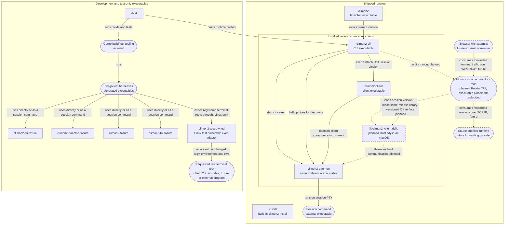

# Executables and dynamic libraries

This diagram covers every climon2-owned executable target and dynamic library,
including development fixtures. Arrows run from consumer to consumed artifact;
labels distinguish execution, communication, and loading.
Solid relationships exist today; dashed relationships are planned.
The current executable relationships apply on macOS and x86_64 GNU/Linux;
native archives are described in [distribution](distribution.md).

`v` represents a [session](../GLOSSARY.md#sessions)'s installed version, not necessarily the current
version selected by the launcher. The CLI starts a new session using its own
version; [attachment](../GLOSSARY.md#attachment-and-control) and termination use the existing session's version.
The installer is a release-payload executable, not a `climon2 install` command.
Installation relationships are outside this consumption diagram.

For workspace crate consumption, see the [crate diagram](crate-relationships.md).

On Linux, `climon2-test-term` builds `climon2-test-owned` as test tooling, never
as a release payload. It opens one test-owned file descriptor before execing
the requested terminal root. Forked descendants inherit that descriptor across
environment clearing and reparenting, so procfs leak checks do not depend on
catching short-lived parents. Process identity, sampled ancestry, session
membership and environment markers remain additional ownership evidence.
Commands that explicitly close inherited descriptors cannot retain this
additional evidence. macOS keeps its kernel process/image ancestry tracking
and does not use this adapter.

**Current:** no climon2 dynamic library is built or shipped. Cargo's ordinary
`lib` targets, including `climon2-core`, `climon2-platform`, and `climon2-vt`,
are not separately loaded dynamic libraries. System and third-party libraries
and individual generated test harness names are outside this artifact inventory.
The macOS library filename in the planned node is not a Linux loader
implementation. Linux native loading and its release-isolation policy remain
subject to the [monitor integration decision](https://github.com/jackgeek/climon2/issues/125).

**Planned:** the [monitor](../GLOSSARY.md#sessions) loads version-matched
[client libraries](../GLOSSARY.md#sessions) directly into
its own process, sharing a loaded library for sessions on the same release.
Each live session has its own client thread. Clients start eagerly, newest
first, with bounded concurrent progress; continuous discovery adds clients for
new sessions. Background clients relay negotiated plugin data without taking
control. Native client crashes can terminate the entire monitor. Ratatui powers
the planned monitor's rendering; its terminal integration is agreed, unimplemented.
The [agreed terminal contract](protocol/terminal-integration.md), not implemented,
selects exact ordered terminal bytes/control/restoration through existing
in-process record queues and monitor-owned `climon2-vt` models, with planned
read-only Rust views for Ratatui. Session bytes never go directly to the host;
daemon query authority stays unique. Monitor-mode daemon presentation uses
effective session geometry, not host/requested dimensions, including background
promotion. Optional core Focus is not a plugin/artifact addition. No executable
placement or new dynamic library is chosen by this amendment.

The [status/activity revision](session-status.md) puts title detection and both
state machines and terminal-signal interpretation in
[daemon](../GLOSSARY.md#sessions) core, not plugins.
The client library carries core title/status reports, structured notification/
progress metadata, and explicit [viewing](../GLOSSARY.md#status-and-attention) information. Metadata is available
without control, not raw [OSC](protocol/TERMS.md#osc) passthrough to host terminals. Root program status
and shell lifecycle choose explicit detection or heuristic fallback.
Plugin implementation, configuration, and interface examples are deferred; the earlier title-plugin
release prerequisite is superseded. No new plugin executable or dynamic library
is specified. These are planned mechanics, not shipped behavior.

The monitor retains a `climon2-vt` model per session for disconnected terminal/
scrollback inspection and reconnects passively without automatic takeover.
Known completion stops retries. These relationships do not introduce a session
survival guarantee or a persisted archive of completed sessions.
The [agreed lifecycle](monitor-lifecycle.md), not implemented, adds exponential
passive recovery, read-only disconnected history with a `Reconnecting...` overlay,
and coordinated concurrent shutdown. Local instance cleanup and joins precede
run-local selector dismissal; stalled cleanup ends the whole monitor process,
never an individual thread or loaded library. Connected revoked sessions show
their placeholder, not cached history. Selector Delete uses the existing Kill
semantics and adds confirmed termination/removal, not another runtime artifact.

The agreed [operational limits](monitor-operational-limits.md), unimplemented,
bound admission, queues, client threads/workers/descriptors and retained shared
release resources. Resource-blocked rows remain visible; history pressure
preserves a recent page. Unsafe growth/cleanup is explicit failure, not client
eviction or unloading. Allocation-aware terminal qualification reopens the
narrow unbounded-engine assumption; it chooses no new executable/library or
consumption arrow, and does not sandbox trusted native code.

The client executable will also load its same-release library for ordinary
operations. The monitor node represents a runtime role, not a decision to ship
an executable named `climon2-monitor`.

The agreed [embedding design](protocol/library-embedding.md) loads
`<executable home>/<session version>/libclimon2_client.dylib` on macOS with no
release fallback. It uses a versioned C interface, per-instance client threads,
release-private dependency resolution, and explicit memory ownership.
Every successfully opened library handle stays loaded until monitor exit,
including handles rejected by later validation. Such releases remain in use
until process exit; completed instance cleanup and joins do not unload them.
These are planned relationships, not shipped artifacts. Complete interface
declarations are specified in [native revision 1](protocol/monitor-client/core-v1.md),
with explicit startup/role, ownership, cleanup and fresh-instance recovery calls.
No new artifact or consumption arrow is added. Monitor-client communication and the
[daemon wire revision 1](protocol/daemon-client/core-v1.md) are agreed
specifications, not implemented.

The planned wire core is independent of the current private Unix socket carrier.
The main/downstream monitor consumes source-monitor sessions over
[TCP/IP](protocol/TERMS.md#tcpip) and presents them as local sessions.
A browser consumes that monitor's forwarded terminal traffic over
[WebSocket](protocol/TERMS.md#websocket) into xterm.js. Dashed arrows above point
from consumer to provider, not in the direction [bytes](protocol/TERMS.md#byte) happen to flow.
No native client library is assumed inside a browser. Routing, multiplexing,
discovery and remote authentication/security remain deliberately unresolved;
same-[UID](protocol/TERMS.md#uid)/private-directory local checks do not define
future transport security. No forwarding implementation is claimed.

Future `climon2 exec --headless` returns after daemon-confirmed creation without
starting an interactive client. A [headless session](../GLOSSARY.md#sessions)
keeps its explicit zero-client survival policy throughout its lifetime, including
after later clients unexpectedly leave; command completion or existing CLI Kill
ends it. The [lifecycle decision](monitor-lifecycle.md) agrees this narrow
exception, not universal persistence or a new executable/library. Implementation
remains unshipped; the current execution arrows above are unchanged.

The planned relationships are indexed by
[Chart the interactive monitor specification](https://github.com/jackgeek/climon2/issues/57);
the hosting and control decision lives in
[Define monitor client ownership and control](https://github.com/jackgeek/climon2/issues/58).
The diagram is a relationship index, not a second interface specification.
