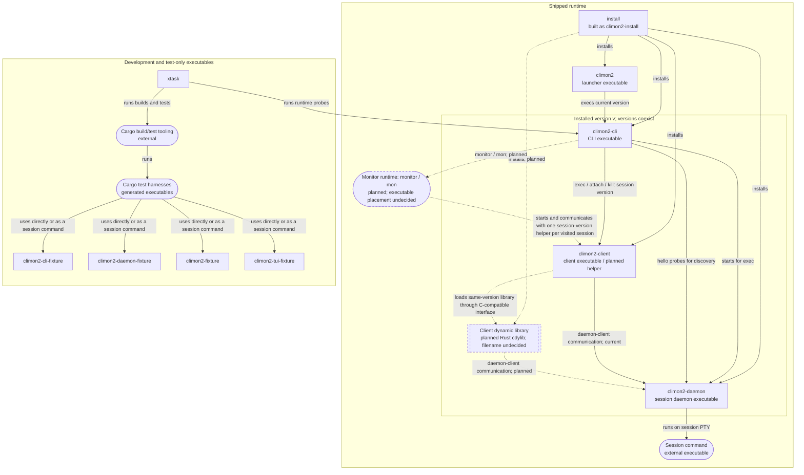

# Executables and dynamic libraries

This diagram covers every climon2-owned executable target and dynamic library,
including development fixtures. Arrows run from consumer to consumed artifact;
labels distinguish execution, communication, loading, and installation.
Solid relationships exist today; dashed relationships are planned.

`v` represents a session's installed version, not necessarily the current
version selected by the launcher. The CLI starts a new session using its own
version; attachment and termination use the existing session's version.
The installer is a release-payload executable, not a `climon2 install` command.

**Current:** no climon2 dynamic library is built or shipped. Cargo's ordinary
`lib` targets, including `climon2-core`, `climon2-platform`, and `climon2-vt`,
are not separately loaded dynamic libraries. System and third-party libraries
and individual generated test harness names are outside this artifact inventory.

**Planned:** the client executable hosts its same-version dynamic library in
one isolated helper process per visited session. The monitor does not load
session client libraries itself. Its node represents a runtime role, not a
decision to ship an executable named `climon2-monitor`. Library filenames,
loading/lifetime details, monitor-helper communication, and the frozen
daemon-client contract remain specification work.

The planned relationships are indexed by
[Chart the interactive monitor specification](https://github.com/jackgeek/climon2/issues/57);
the hosting and control decision lives in
[Define monitor client ownership and control](https://github.com/jackgeek/climon2/issues/58).
The diagram is a relationship index, not a second interface specification.
