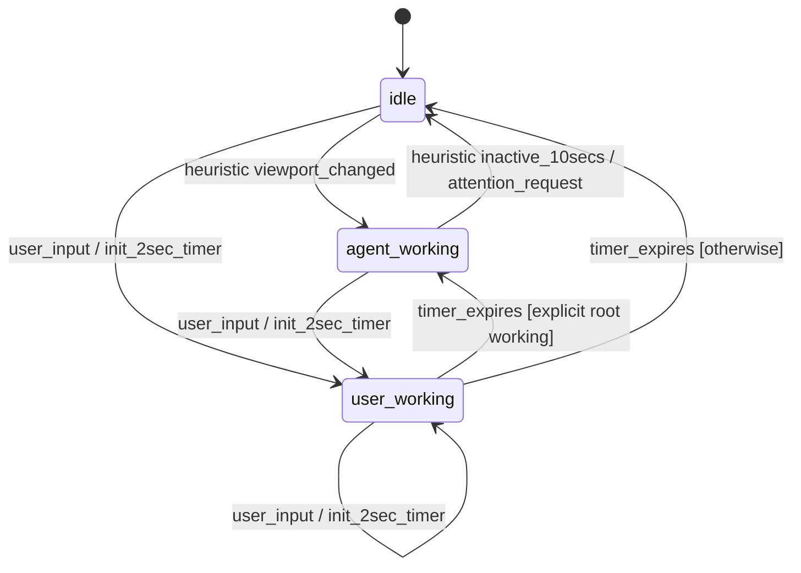
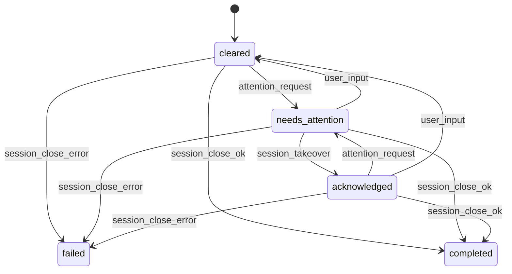

# Session status, attention, and activity

**Status: agreed specification, not implemented.** The developer confirmed this
revision on 2026-11-06. It supersedes the earlier two-state activity heuristic,
title-plugin requirement, creation-time monitor ordering, and
[attention](../GLOSSARY.md#status-and-attention) rules in
[startup/discovery](https://github.com/jackgeek/climon2/issues/59).
No executable implementation or automated acceptance evidence is claimed here.
The approved [wire revision 1](protocol/daemon-client/core-v1.md), recorded for
[#67](https://github.com/jackgeek/climon2/issues/67), subsequently amends
[viewing](../GLOSSARY.md#status-and-attention),
explicit acknowledgement and local notification behavior below, without
changing activity detectors, deadlines or either state machine.
The subsequent agreed [#63 terminal contract](protocol/terminal-integration.md)
adds [host](../GLOSSARY.md#sessions)/application focus, terminal-style history, canonical monitor
presentation, and #64/#59 lowercase-j/configuration amendments. It is also
unimplemented; neither diagram below changes.

The [session daemon](../GLOSSARY.md#sessions) owns both
[activity state and attention state](../GLOSSARY.md#status-and-attention).
The [monitor](../GLOSSARY.md#sessions) displays their effective
[session status](../GLOSSARY.md#status-and-attention); it does not run competing
copies of these machines. Title detection, terminal-signal interpretation, and
these machines belong in daemon core.
[Plugin](../GLOSSARY.md#protocol-and-plugin-concepts) implementation,
enable/disable configuration, and interface examples are deferred. There is no
plugin release prerequisite.

Use the [domain glossary](../GLOSSARY.md), [technical terms](protocol/TERMS.md),
and [protocol reference](protocol/README.md) with this document. The
[daemon contract](https://github.com/jackgeek/climon2/issues/67),
[monitor-client communication](https://github.com/jackgeek/climon2/issues/66),
and [interface schemas](https://github.com/jackgeek/climon2/issues/71) still own
exact messages, fields, compatibility, validation, and examples.

## Events and two FSMs

The two [FSMs](protocol/TERMS.md#fsm) start with activity `idle` and attention
`cleared`. The daemon also owns
the current detection mode: `heuristic` initially, `explicit`, or
`fallback_pending`. This mode selects the activity detector; it is not a
reported session status. Activity and attention evolve independently, connected
by internal [events](protocol/TERMS.md#event).

Both `agent_working` and `user_working` project to the existing `running` status:

```text
activity_status = activity == idle ? idle : running
status = attention == cleared ? activity_status : attention
```

For example, `idle` plus `needs_attention` displays `needs_attention`.
Activity continues to evolve while attention masks it. Switching between
`agent_working` and `user_working` alone does not change effective status.

Dispatch internal events to completion before processing another event. Apply
an emitted `attention_request` to the attention machine before publishing the
resulting effective status; do not report an intermediate `idle` for an
inactivity transition that also requests attention. When accepted input and
timer/sample work are already pending in the same dispatch turn, process input
first. Preserve terminal-signal stream order. Cancel obsolete deadlines and
ignore expiry events from earlier timer arms or detection scopes. This is
daemon-internal dispatch, not a new external event bus or wire schema.

### Activity



This diagram covers heuristic changes and user input. Root
[OSC](protocol/TERMS.md#osc) 7501 reports and shell lifecycle signals can
override any live activity state as specified below.

`init_2sec_timer` is an action, not a persistent activity state. Each qualifying
`user_input` immediately enters/remains in `user_working`, cancels any agent
inactivity deadline, and arms/restarts a hardcoded **2,000 ms** deadline.
Viewport changes during this window neither enter `agent_working` nor restart
the user timer.

At user-timer expiry, restore `agent_working` only if detection is `explicit`
and the current root record in that scope still says `working`; do not require
the application to repeat an unchanged report. Otherwise enter `idle`. This
expiry never requests attention. In heuristic mode, capture a fresh viewport/
title baseline and resume idle change detection. Output confined to the input
window is deliberately ignored; continuing changes after the window can start
another agent-working period. With ordinary sampling, detection can occur
roughly 2,500-3,500 ms after the last input, assuming subsequent sampled changes.
The window is a heuristic, not proof of who produced output.

Explicit root reports supersede `user_working` immediately and cancel its
deadline. Leaving `user_working` cancels that deadline. The fallback grace
period, when armed, is independent of the user timer.

### Attention



The heuristic `agent_working -> idle` inactivity transition emits
`attention_request`. Root OSC 7501 attention-bearing reports and recognized
notification signals also emit it, without requiring an activity transition.
User-timer expiry, fallback expiry, cleanup, and shell boundaries do not.
Requests are not restricted to `cleared`: an acknowledged session can need
attention again. A repeated request while already `needs_attention` leaves it
unchanged, rather than starting another attention episode.

`session_takeover` here denotes accepted explicit acknowledgement, not a control
[grant](../GLOSSARY.md#attachment-and-control). Explicit ordinary attach, focus/selection and menu close/cancel may
acknowledge current pending attention once ready and unobstructed, including a
session whose monitor [client](../GLOSSARY.md#sessions) already retains
[control](../GLOSSARY.md#attachment-and-control).
The [distinct request](protocol/daemon-client/request-acknowledge.md) carries no
observed episode ID and validates the current
[controller](../GLOSSARY.md#attachment-and-control), matching period/
[restoration](../GLOSSARY.md#restoration-and-presentation),
[readiness](../GLOSSARY.md#protocol-and-plugin-concepts) and latest reported viewing true. No pending episode
gives explicit no-change success. Cancel deferred acknowledgement if local
target context changes before submission. Opening/browsing menus never
acknowledges; merely being visible does **not** acknowledge a new request.
If attention arrives while the user is already viewing the session, it remains
`needs_attention` until actual user input clears it or an accepted explicit
action above acknowledges it.
Here focus/selection is an explicit user action, not host focus-in or the
non-user [application Focus operation](protocol/daemon-client/request-focus.md).
The global lowercase j attention jump may select/acquire only if needed, then
acknowledge once applied, painted, ready and unobstructed. Focus never clears
attention or counts as user input.

`user_input` is actual user-originated application
[bytes](protocol/TERMS.md#byte), including paste, accepted from the current
ready controller. It clears either `needs_attention` or `acknowledged`.
Monitor shortcuts, selector navigation, terminal-query replies, and injected
work do not count. Acceptance is not proof of application consumption.

A confirmed command exit of zero produces `completed`; a confirmed nonzero
exit or signal termination produces `failed`. Those are terminal attention
states: late input, requests, or viewing changes cannot clear them.
Confirmed completion/failure cancels all activity deadlines and stops
observation; late viewport, timer, and terminal-signal events cannot restart
activity or generate attention requests.
[Detach](../GLOSSARY.md#attachment-and-control) is not completion. Connection
loss without a confirmed command result does not invent a final outcome.

## Snapshot sampling and the inactivity deadline

The **agent inactivity algorithm runs only in heuristic mode while activity is
`agent_working`**. Lightweight idle sampling still detects the changes needed
to enter that state. Explicit mode does not infer activity from viewport
changes or expire silent `working` reports. Fallback mode observes quiet for
its separate grace period, not to infer agent work.

Capture a baseline before processing command output. Each sample reads the
currently active viewport as a string of characters plus terminal height and
width. Compare title separately. This samples terminal state, not raw output
bytes or restoration escape sequences.

Choose a fresh random delay from **500 to 1500 ms** for each sampling iteration.
While heuristic `agent_working`, shorten it to the remaining agent deadline:

```text
remaining = max(0, 10000 ms - elapsed)
next_delay = min(random_delay, remaining)
```

Elapsed time uses a [monotonic clock](protocol/TERMS.md#monotonic-clock).
The **10,000 ms threshold is hardcoded**, not a setting in the climon2
configuration file. The user timer and fallback deadline also use this clock;
the user timer is scheduled independently of random sampling.
[UTC](protocol/TERMS.md#utc) time used for status reporting is separate from
elapsed-time measurement.

At each heuristic sample outside `user_working` and prompt-rendering exclusion:

1. If height or width changed, replace the character baseline and restart the
   timer. Do not compare differently sized grids or change activity solely
   because of resize. An independently changed title still counts as activity.
2. With matching dimensions, different characters count as activity. A changed
   title also counts. Either sets activity to `agent_working` and arms/restarts
   the agent inactivity timer. Retain the current characters/title as the next
   comparison baseline, so a change is not counted repeatedly.
3. Check changed content before expiring the timer. If activity remains
   `agent_working` and elapsed time reaches 10,000 ms, set it to `idle`, emit
   `attention_request`, and disarm the inactivity deadline.
4. Continue ordinary random sampling while `idle`. A new meaningful change
   starts another agent-working period and deadline.

Do not alternate `idle` and `agent_working` during uninterrupted silence, or spin on
an expired zero-delay timer. A session silent from startup remains
`idle`/`cleared`; it must first become heuristic `agent_working` before agent
inactivity can request attention.

Styles/colors, cursor-only movement, and identical redraws do not count.
Switching normal/alternate screens with identical sampled characters and
dimensions does not count either. Changes that appear and disappear wholly
between samples are not individually tracked by this strategy.

Sampling must not deliberately overshoot an armed deadline. Execution can
still be late because of scheduler stalls. Schedule work without blocking
daemon connection handling; do not copy the viewport for every output byte.
Exact character-string representation and allocation budgets remain
implementation/interface work, not an additional activity signal.

## Explicit program status and fallback

Use the [Program Status Protocol, revision 0.4](https://www.superlogical.com/rex/docs/build/program-status)
for OSC 7501 framing, validation, record replacement, identifiers, limits,
and capability detection. Interpret it in daemon core before filtering; do
not forward raw sequences to the host. A valid root status report proves
application support; a capability query does not. No prior shell-integration
signal is required. The daemon answers queries locally with its supported
states/kinds. It does not query applications for support or liveness.

Only the root record (no `id`) drives these FSMs and detection mode. Child
reports and child-subtree clearing affect records, not session activity,
attention, or detector selection. Do not aggregate child `working`/`blocked`
into session status. Record validation and lifecycle still follow the
upstream protocol; unsupported/invalid reports do not become `idle`.

Apply root reports from any live activity state:

| Root report | Activity | Detection mode | Attention action |
|---|---|---|---|
| `working` | `agent_working` | `explicit` | None |
| `idle` | `idle` | `explicit` | Emit `attention_request` |
| `done` | `idle` | `explicit` | Emit `attention_request` |
| `blocked` | `idle` | `explicit` | Emit `attention_request` |
| `error` | `idle` | `fallback_pending` | Emit `attention_request` |
| `clear` | `idle` | `fallback_pending` | None |

Each report cancels activity deadlines and replaces the previous root-driven
decision. Every root `idle`/`done`/`blocked`/`error` report requests attention,
even if activity was already `idle` or the report repeats a value. Requests
while `needs_attention` coalesce; a subsequent report after acknowledgement or
input-clearing can start a new episode. A task's `done`/`error` is not a
confirmed exit of the session command and never sets `completed`/`failed`.

Explicit `working` may remain silent indefinitely: there is no heartbeat and
no ten-second agent inactivity deadline. A new root report can override it,
as can accepted input or a lifecycle boundary.

### Ten-second fallback grace period

Root `error` or root `clear` starts/restarts a separate hardcoded **10,000 ms
of viewport inactivity** before returning to heuristics. Root `clear` deletes
all records, including children, but neither requests attention nor clears
existing attention. Absence of records during grace is not immediate fallback.

At grace start, capture a viewport/title baseline and arm its deadline.
Observe using the same random sampling, dimension checks, character/title
comparison, and content-before-expiry ordering as above. Clamp delays to the
remaining grace deadline. Meaningful character/title changes or resize
replace the relevant baseline and restart the grace deadline, without
entering `agent_working` or emitting attention. Do not arm the agent inactivity
deadline during grace.

| Event during grace | Effect on grace |
|---|---|
| Root `working`/`idle`/`done`/`blocked` | Cancel; apply the report and use explicit detection. |
| Root `error`/`clear` | Restart; apply the report's attention rule. |
| Shell boundary `A`/`D`/`C` | Cancel; resume heuristics immediately as described below. |
| Confirmed session command exit | Cancel all observation/timers; apply terminal attention status. |
| Child report or notification signal | No detection-mode change. |
| Accepted user input | No direct grace restart/cancellation; apply the ordinary input rules. |

Grace observation continues during `user_working` solely to measure quiet;
resulting viewport changes can restart grace but cannot infer agent work or
extend the two-second user deadline. Input bytes alone do not restart grace.

On grace expiry, select `heuristic`, capture a fresh baseline, and emit no
attention request. Activity remains `idle`, except that an unexpired
`user_working` window and its deadline must be preserved. Continue ordinary
heuristic detection after that window expires. Disarm the grace deadline
instead of spinning on an expired timer.

A full terminal reset (`RIS`) removes every OSC 7501 record. In explicit or
fallback mode it follows root `clear` activity/grace semantics, with no
attention request. In heuristic mode it refreshes the observation baseline
without manufacturing a status change. A soft reset does not clear records.

### Shell boundaries and prompt rendering

Observe [OSC 133 shell integration](https://learn.microsoft.com/en-us/windows/terminal/tutorials/shell-integration)
locally before filtering:

| Marker | Meaning | Detection action |
|---|---|---|
| `A` | Prompt begins | Retire the prior explicit scope; resume heuristics, excluding prompt rendering. |
| `B` | Prompt ends; command-line input begins | End prompt-rendering exclusion and capture a fresh baseline; do not otherwise reset detection. |
| `C` | Command execution/output begins | Retire the prior explicit scope; resume heuristics and end prompt-rendering exclusion. |
| `D` | Command finishes | Retire the prior explicit scope; resume heuristics. |

Each `A`/`D`/`C` boundary cancels activity deadlines, enters `idle`, and captures
a fresh baseline, without requesting or clearing attention. Repeated boundaries
are harmless. Require a fresh root report to activate explicit detection in the
new scope; stale retained records must not reactivate it on user-timer expiry.
Apply upstream record-lifetime rules: at `A`, discard `working`/`blocked`;
`done`/`error` survive but cannot suppress heuristics for the next command.
An OSC 133 command result is not the session command's confirmed exit.

Between `A` and `B`/`C`, exclude viewport/title changes from heuristic activity
inference. This exclusion does not reject accepted input or explicit reports,
and does not prevent independent fallback-grace observation. If neither
closing marker arrives, exclusion persists; correct shell integration is
required.

Fallback has a deliberate limit. A supporting app can report `working` and
then exit into a still-live shell that emits no OSC 133, without sending
`error`/`clear`. There is no reliable signal to end explicit mode in that case.
Do not invent a heartbeat or time out silent explicit work. A later lifecycle/
cleanup signal or confirmed session command exit resolves it.

## Notification and progress signals

Recognized notifications emit `attention_request` independently of activity,
detection mode, or viewing. They do not cancel activity timers, end explicit
mode, or imply task/session completion.

| Source | Requests attention | Does not request attention |
|---|---|---|
| [OSC 9](https://iterm2.com/documentation-escape-codes.html) | Text notification form | [Progress and other control operations](https://conemu.github.io/en/AnsiEscapeCodes.html#ConEmu_specific_OSC), including OSC 9;4. |
| [OSC 99](https://sw.kovidgoyal.net/kitty/desktop-notifications/) | A complete logical notification | Incomplete chunks, capability/liveness queries, close operations, and auxiliary/control data on their own. |
| [OSC 777](https://codeberg.org/dnkl/foot/src/branch/master/doc/foot-ctlseqs.7.scd) | The `notify` subcommand, with [climon2 normalization](protocol/daemon-client/core-v1.md#source-normalization) | Other extension subcommands. |

Accumulate OSC 99 notification chunks according to its protocol, requesting
attention only when the logical notification is complete, not once per chunk.
Auxiliary data does not independently create an attention event. Parse complete
validated sequences, not number substrings in terminal text. Unsupported
operations are not notifications. No complete desktop-notification protocol
implementation, external action execution, or activation/close acknowledgement
is implied; unsupported notification queries/control operations are ignored.

In addition to attention detection, relay structured notification and progress
metadata through the client to subscribed monitors/clients, including background,
noncontrolling, and revoked subscribers. Progress operations such as OSC 9;4
can support future progress bars/spinners without requesting attention.
This metadata is not live terminal-content mirroring and never grants control.
Do not forward raw OSC sequences into outer terminals for interpretation.
The [agreed wire reference](protocol/daemon-client/core-v1.md) specifies
structured schemas, capabilities, ordering/correlation, source normalization
and retention of current progress. Native declarations remain #71 and
numeric queue/assembly limits #69.
Implementing progress [UI](protocol/TERMS.md#ui) is not part of this revision.

## Viewing is not merely control

[Viewing](../GLOSSARY.md#status-and-attention) is reported explicitly per
[attachment](../GLOSSARY.md#attachment-and-control). Only a connected controller
whose selected session has reached displayed
[readiness](../GLOSSARY.md#protocol-and-plugin-concepts) can count as viewing.
A background client may retain control without viewing.

Switching away, exiting, disconnecting, or
[revocation](../GLOSSARY.md#attachment-and-control) clears that attachment's
viewing status. **Opening any menu clears this monitor's viewing** without
releasing control or restoration; this supersedes the earlier selector-overlay
rule. Highlighting/browsing never acknowledges. Ordinary interactive attach
can report viewing only once ready and unobstructed.

For the monitor this also requires a live viewport in usable space and host focus
when reportable. Host focus loss, scrolled history, stale inspection,
too-small/unavailable canvas, and nonmodal notification coverage clear viewing
without releasing control or applied readiness. Host focus-in or a disappearing
notification alone never acknowledges attention. Without host focus reports,
assumed focus is explicitly best-effort, not an invented detector.

Application keyboard focus is distinct: a selected ready host-focused target
without modal UI is focused; normal scrollback and nonmodal
[toasts](protocol/TERMS.md#toast) retain it,
while switching/menu opening sends focus-out when valid. Optional core
`focus-v1` reports desired focus with current authority, even when application
reporting is disabled, and truthfully distinguishes state acceptance from bytes
accepted for forwarding. Newly enabled reporting emits current known state once;
new readiness synchronizes latest local state without replaying old requests.
Missing library/daemon focus support keeps the session usable with an explicit
limitation. These are [terminal focus semantics](protocol/terminal-integration.md#host-focus-and-application-focus),
not another attention detector.

Only this monitor's own unobstructed viewing suppresses its
[toast](protocol/TERMS.md#toast) notification; another client's or monitor's
viewing never suppresses it. No aggregate viewing broadcast/schema is added.
Per-attachment reports to the daemon still validate acknowledgement.
Viewing does not automatically change the attention [FSM](protocol/TERMS.md#fsm).
Explicit accepted acknowledgement and accepted real input are the
acknowledgement/clearing events.

## Reporting, ordering, and initial selection

On connection, report the current effective daemon status and the UTC timestamp
at which that effective value last changed. Continue reporting changes
regardless of control, menu visibility, or input readiness. Establish current
state and subsequent ordered changes without a subscription gap.

Only effective-status changes update its timestamp. Hidden activity changes
under `needs_attention`, transitions between the two working states, and
detection-mode changes alone do not reorder the row. A new monitor receives the
stored timestamp, not its own connection time.
The [wire Status](protocol/daemon-client/core-v1.md#shared-types) has required
state, UTC `YYYY-MM-DDTHH:MM:SS.mmmZ` changed time and nullable episode counter.
Episodes increase per session, are nonzero, coalesce while pending, survive
acknowledgement and clear to null; timestamps are not identities.
Atomic [Initial metadata](protocol/daemon-client/event-initial-metadata.md)
follows Open response, then changes are gap-free. Final transition is carried by
[Command final](protocol/daemon-client/event-command-final.md), not duplicated
as Status changed. Native representations remain #71.

Order session rows by:

| Priority | Status |
|---|---|
| 1 | `needs_attention` |
| 2 | `acknowledged` |
| 3 | `running` |
| 4 | `idle` |
| 5 | `failed` |
| 6 | `completed` |
| 7 | `disconnected` |

Within a group, sort newest status-change UTC timestamp first, then ascending
full session [GUID](protocol/TERMS.md#guid) for deterministic ties. GUIDs are
internal identity only; never display them in the menu. This replaces
creation-time row ordering.

Collect status passively with bounded progress before initial selection, then
select the first row in this order. Unknown/unavailable status is not
`cleared`; report incomplete discovery explicitly rather than fabricate a clean
result. Compatibility and placement of unsupported/unknown rows still require
the discovery/interface decisions.

Initial choice remains pinned while it starts. Definitive loss before readiness
permits reranking remaining eligible candidates; other startup failures remain
visible rather than silently skipping the candidate. At most one attempt per
candidate per discovery pass remains the rule. Subsequent reports re-sort rows
without changing selected/highlighted identity or redirecting confirmation.

Discovery still finds live sessions; final views retained within one monitor
do not create a persisted startup archive. Eager all-session client creation
and its existing bounded newest-first scheduling remain distinct from the
revised status-based row ordering and initial selection.

### Global attention jump and hints

Configured prefix + **lowercase `j`** chooses the most recent **currently
connected** `needs_attention` row at keypress time, by newest daemon status-change/
attention time and the existing ascending GUID tie-breaker.
Exclude acknowledged, completed/failed, and stale/disconnected rows.
Choose dynamically, never from an old toast target; ordinary sorting still
preserves selected/highlighted identity.
The command works in selector, stale cache inspection, placeholder, or empty UI.
Close overlays, explicitly select/acquire only if needed, then apply/paint and
acknowledge once unobstructed/ready, cancelling deferred acknowledgement if target
context changes. With none eligible keep selection and visibly report
`No sessions need attention`. Uppercase J remains unknown literal input; pasted
prefix+j stays data and s/x stay unchanged.

Needs-attention toasts hint the actual configured prefix plus lowercase j,
describing the dynamic most-recent jump rather than guaranteeing their own session.
Planned `monitor.show_key_hints` is boolean, default true; it controls all implicit
toast/chrome/selector/empty hints, not bindings or application text. Validate the
startup snapshot before terminal changes; wrong type/duplicate known fields fail,
missing fields default, no live reload, and no new monitor bindings.
See the [canonical amendments](protocol/terminal-integration.md#attention-jump-and-configurable-hints)
and [future configuration example](../README.md#planned-monitor-settings-not-implemented).

## Connection loss and retained terminal views

[Connection status](../GLOSSARY.md#status-and-attention) is monitor-owned,
separate from the two daemon FSMs. Keep one `climon2-vt` model per monitor-owned
session, not per short-lived socket. Retain received terminal content and
bounded local scrollback after disconnection for read-only inspection. Mark it
disconnected/stale; never forward application input while disconnected.
During live normal-screen use this is internal terminal-style history, not host
[native scrollback](../GLOSSARY.md#restoration-and-presentation).
Wheel without application capture scrolls it; typing returns
live and forwards when selected/controlling/ready, not consumed by an inspection
mode. Anchor a scrolled viewport through output; eviction moves to oldest retained
with an explicit [truncation notice](../GLOSSARY.md#restoration-and-presentation), never pins unbounded rows or jumps to live.
Alternate-screen wheel never exposes normal history; without application capture
it becomes arrows only when alternate-scroll is enabled. Returning normal
restores normal buffer/history. Never-controlled passive clients have no history.

Preserve a definitively received `completed` or `failed` status after the
connection closes. Otherwise use the `disconnected` ordering group and the
monitor's recorded UTC disconnection time; retain the last daemon status/time
as stale detail rather than overwriting them.

Use automatic exponential passive backoff for uncertain transport loss,
recoverable startup failure (including missing libraries), and safely contained
worker panics. Permanent protocol/interface rejection and invalid configuration
stop retries with explicit errors. Definitive completion also stops retries.
Wait for previous-instance deliveries/handles, workers and thread cleanup/join
before any fresh attempt; never overlap replacement instances.
The [agreed, unimplemented lifecycle contract](monitor-lifecycle.md) owns these
rules; [operational limits](monitor-operational-limits.md#passive-retry)
specifies numerical delays/caps/jitter.
Reconnect passively and refresh status/title without automatically taking
control, even if the session remains selected. Explicit user action resumes
control; apply a fresh valid restoration before presenting content as current
or enabling input. Never replay indeterminate work, including Kill. Stop new
retry scheduling during shutdown or confirmed pending termination/removal;
passive recovery may still establish an indeterminate Kill's outcome.
Every fresh authoritative restoration replaces the whole model/history
transactionally, not union/dedup; absent older local history may be discarded.
Partial/superseded models never become current. Disconnected cache is read-only;
selector Enter explicitly opens it without Acquire or acknowledgement. Overlay
exactly `Reconnecting...` while recovery is scheduled or active, or an explicit
disconnected/error overlay when permanent rejection stops recovery. Connected
revoked selection shows the takeover placeholder: no revoked-cache inspection
route exists. Remove the reconnect overlay on recovery; a non-controller still
shows the placeholder until explicit acquisition. Completed/failed content may
display retained output directly read-only. Passive without a cache says none
available. No prefix+h/prefix+r or extra history/retry binding is added.
See the [history and replacement contract](protocol/terminal-integration.md#normal-history-alternate-screen-and-stale-inspection).

This does not permit live read-only mirroring after revocation, recover output
that was never received, or record every alternate-screen update. Per-session/
aggregate retention limits and exhaustion behavior are specified in
[operational limits](monitor-operational-limits.md#memory-history-and-admission).
Memory pressure shortens captured history to its newest page, never erases that
page to admit another client. Preserve the last safely captured page if a new
model update is explicitly rejected for exceeding allocation limits.
The approved [succession rules](protocol/daemon-client/core-v1.md#membership-and-succession)
amend final-attachment assumptions: controller departure by detach or loss
first hands back to the most recently controlling attachment, otherwise promotes
the newest accepted passive registration, before final-participant
[leave policy](../GLOSSARY.md#attachment-and-control). Registration alone does
not take over a detached session. Committed termination overrides succession.
No new native-crash survival guarantee is implied. Future
[headless sessions](../GLOSSARY.md#sessions) explicitly survive zero clients for
their entire lifetime, including later attachment loss, until command completion
or Kill; ordinary sessions retain leave policy. Future
`climon2 exec --headless <command> [args...]` returns only after daemon-confirmed
creation. This CLI spelling and lifetime are agreed in
[lifecycle](monitor-lifecycle.md#future-headless-creation-and-existing-cli-kill),
not implemented; preserve existing CLI kill and test it with headless sessions.

Keep selection identity through loss/completion/revocation/failed acquisition;
never automatically acquire a replacement. Retain rows and metadata for this
run unless explicitly removed, and continue discovery through empty/all-final
states. [Selector Delete](monitor-selector.md#delete-terminate-and-remove) waits
for definitive termination and local cleanup/join before run-local dismissal,
with no same-run rediscovery or acquiring fallback.

## Titles and notifications

Daemon core supplies its current terminal title and ongoing changes without
requiring control or scraping a monitor's screen. Use the latest non-empty
title in the menu; otherwise use command plus arguments. Unsupported title
delivery on older daemons does not block takeover. Render titles literally and
mark cached data stale when delivery becomes uncertain.
The monitor's permanent top row shows the title/fallback as a label only,
marqueeing only overflowing label text with
[display-cell](protocol/TERMS.md#display-cell)-safe clipping and
restart on label changes; status/control/error remain stationary. Full details
stay in the selector. Never change the host title.

Users do not set terminal titles through climon2. Future user-assigned,
persisted session names are separate and will appear alongside a non-empty
terminal title. Naming remains deferred, including revisiting the
[write-once metadata rule](adr/0005-frozen-session-metadata-core.md).

Show one [toast](protocol/TERMS.md#toast) for an unviewed attention episode or a
confirmed unviewed completion/failure. Acknowledgement and activity-only changes
do not notify. Repeated state reports and reconnects do not duplicate an
episode's notification. `acknowledged -> needs_attention` is a new episode; a
new monitor may notify once about an existing pending episode. Cached
disconnected state alone cannot manufacture a new episode.

Attention arriving while a menu is open toasts immediately **over the menu**,
without waiting for close or a daemon round trip. Still-pending attention
previously suppressed and never toasted becomes eligible when the menu opens.
Acknowledged/cleared attention is not pending. Deduplicate per episode across
this monitor's whole lifetime, including reconnects.

A final result first learned while viewing stays suppressed forever in this
monitor; later menu opening never resurrects its toast. First learned unviewed
notifies once. Its deduplication identity is session GUID plus the fixed
category `final outcome`, not exit-versus-signal kind, with no second counter.
Inconsistent repeats cannot authorize another toast. Terminal status/result
must agree: completed is normal exit zero, failed nonzero exit or signal.

Nonmodal toasts may cover application cells: clear viewing but retain keyboard
focus, applied restoration and ready key forwarding. Disappearance restores
viewing only when live/ready/focused/unobstructed, never auto-acknowledgement.
Existing application drags retain their initial target under toast appearance;
new toast clicks are monitor-owned dismissals without takeover. Invalid target/
authority discards gesture remainder through end, just as stale paste is drained,
never routed to another/background session. Modal menus also clear keyboard focus.

## Remaining work and required evidence

The daemon wire schemas, compatibility/rejection, source normalization, viewing
validation and notification identities are now agreed in #67, not implemented.
The [lifecycle specification](monitor-lifecycle.md) now agrees recovery,
concurrent shutdown, truthful Leave/closure/outcome/cleanup/join evidence,
bounded whole-process fail-stop and headless lifetime, all unimplemented.
The [operational specification](monitor-operational-limits.md) now agrees
numerical budgets/rate limits/retry intervals/retention (#69), not implemented.
Native declarations (#71) and final automated acceptance (#62) remain open.
Terminal application is now agreed in the [#63 contract](protocol/terminal-integration.md),
not implemented; its required real-monitor-host evidence includes history
replacement, coherent resize, supported keys/mouse/paste, host/application focus,
dynamic j/hints, gesture/notification routing, query authority and failure isolation.

[Automated acceptance](https://github.com/jackgeek/climon2/issues/62) must cover
the following, with no claim that this documentation supplies that evidence:

- Activity/attention transitions, two-second re-arming, stale expiry rejection,
  both input-clearing paths, and no visibility auto-acknowledgement.
- Snapshot/title/resize cases, random scheduling, content-before-expiry and
  deadline clamping, initial silence, and no activity inference during the
  user window or prompt rendering.
- Both working states projecting to `running`, effective-only timestamps,
  unchanged ordering, and atomic attention-request dispatch without transient
  idle reports.
- Root-only OSC 7501 effects, repeated attention-bearing reports, validation
  and record limits, capability queries not activating explicit detection,
  indefinite silent explicit work, and restoration of explicit working after
  user-timer expiry.
- Error/clear grace entry, restart and cancellation, reset behavior, resize/
  title/character quiet measurement, independent user deadlines, and expiry
  without another attention request.
- OSC 133 boundaries, prompt exclusion and baseline refresh, retained
  done/error not pinning detection, no invented session exit, and the documented
  missing-lifecycle limitation.
- OSC 9 progress/control exclusions, OSC 99 complete-notification chunking,
  OSC 777 subcommand filtering, and structured metadata delivery without control
  or raw host passthrough.
- Passive startup/reconnect, retained disconnected inspection, terminal-state
  immunity to late events, and duplicate-free episode notifications.

Actual monitor-rendering evidence remains required; isolated helpers are not
sufficient. No plugin implementation or progress-UI evidence is required by
this revision.
