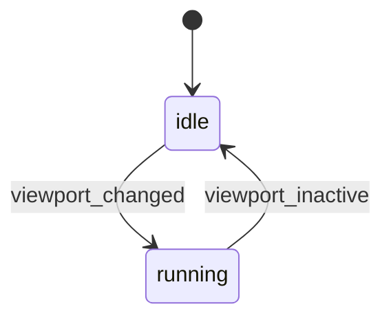
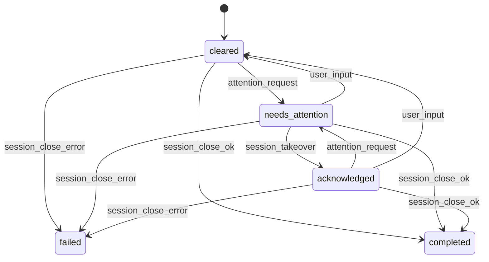

# Session status, attention, and activity

**Status: agreed specification, not implemented.** The developer confirmed this
revision on 2026-11-04. It supersedes the earlier title-plugin requirement,
creation-time monitor ordering, and intermediate attention rules in
[startup/discovery](https://github.com/jackgeek/climon2/issues/59).
No executable implementation or automated acceptance evidence is claimed here.

The [session daemon](../GLOSSARY.md#sessions) owns both
[activity state and attention state](../GLOSSARY.md#status-and-attention).
The [monitor](../GLOSSARY.md#sessions) displays their effective
[session status](../GLOSSARY.md#status-and-attention); it does not run competing
copies of these machines. Title detection and these machines belong in daemon
core. [Plugin](../GLOSSARY.md#protocol-and-plugin-concepts) implementation,
enable/disable configuration, and interface examples are deferred. There is no
plugin release prerequisite.

Use the [domain glossary](../GLOSSARY.md), [technical terms](protocol/TERMS.md),
and [protocol reference](protocol/README.md) with this document. The
[daemon contract](https://github.com/jackgeek/climon2/issues/67),
[monitor-client communication](https://github.com/jackgeek/climon2/issues/66),
and [interface schemas](https://github.com/jackgeek/climon2/issues/71) still own
exact messages, fields, compatibility, validation, and examples.

## Two independent machines

Activity starts at `idle`; attention starts at `cleared`. Their effective value
is:

```text
state = attention == cleared ? activity : attention
```

For example, `idle` plus `needs_attention` displays `needs_attention`.
Activity continues to evolve while attention masks it.

### Activity



`viewport_changed` includes changed sampled characters or terminal title.
Further changes while already `running` restart its timer without a state
transition. A resize restarts observation as described below, but does not
itself change activity.

### Attention



Every genuine `running -> idle` transition emits `attention_request`. The
detector does not restrict requests to `cleared`: an acknowledged session can
need attention again. A repeated request while already `needs_attention`
leaves it unchanged, rather than starting another attention episode.

`session_takeover` here denotes explicit selection/takeover acknowledgement,
including selecting a session whose monitor client already retains
[control](../GLOSSARY.md#attachment-and-control). That case need not request a
new control grant. Merely being visible does **not** acknowledge a new request.
If attention arrives while the user is already viewing the session, it remains
`needs_attention` until actual user input clears it or an explicit selection/
takeover acknowledges it.

`user_input` is actual user-originated application
[bytes](protocol/TERMS.md#byte), including paste, accepted from the current
ready controller. It clears either `needs_attention` or `acknowledged`.
Monitor shortcuts, selector navigation, terminal-query replies, and injected
work do not count. Acceptance is not proof of application consumption.

A confirmed command exit of zero produces `completed`; a confirmed nonzero
exit or signal termination produces `failed`. Those are terminal attention
states: late input, requests, or viewing changes cannot clear them.
[Detach](../GLOSSARY.md#attachment-and-control) is not completion. Connection
loss without a confirmed command result does not invent a final outcome.

## Snapshot sampling and the inactivity deadline

Capture a baseline before processing command output. Each sample reads the
currently active viewport as a string of characters plus terminal height and
width. Compare title separately. This samples terminal state, not raw output
bytes or restoration escape sequences.

Choose a fresh random delay from **500 to 1500 ms** for each iteration. While
`running`, shorten it to the remaining inactivity deadline:

```text
remaining = max(0, 10000 ms - elapsed)
next_delay = min(random_delay, remaining)
```

Elapsed time uses a [monotonic clock](protocol/TERMS.md#monotonic-clock).
The **10,000 ms threshold is hardcoded**, not a setting in the climon2
configuration file. [UTC](protocol/TERMS.md#utc) time used for status reporting
is separate from inactivity measurement.

At each scheduled sample:

1. If height or width changed, replace the character baseline and restart the
   timer. Do not compare differently sized grids or change activity solely
   because of resize. An independently changed title still counts as activity.
2. With matching dimensions, different characters count as activity. A changed
   title also counts. Either sets activity to `running` and restarts the timer.
3. Check changed content before expiring the timer. If activity remains
   `running` and elapsed time reaches 10,000 ms, set it to `idle`, emit
   `attention_request`, and disarm the inactivity deadline.
4. Continue ordinary random sampling while `idle`. A new meaningful change
   starts another running period and deadline.

Do not alternate `idle` and `running` during uninterrupted silence, or spin on
an expired zero-delay timer. A session silent from startup remains
`idle`/`cleared`; it must first become `running` before inactivity can request
attention.

Styles/colors, cursor-only movement, and identical redraws do not count.
Switching normal/alternate screens with identical sampled characters and
dimensions does not count either. Changes that appear and disappear wholly
between samples are not individually tracked by this strategy.

Sampling must not deliberately overshoot an armed deadline. Execution can
still be late because of scheduler stalls. Schedule work without blocking
daemon connection handling; do not copy the viewport for every output byte.
Exact character-string representation and allocation budgets remain
implementation/interface work, not an additional activity signal.

## Viewing is not merely control

[Viewing](../GLOSSARY.md#status-and-attention) is reported explicitly per
[attachment](../GLOSSARY.md#attachment-and-control). Only a connected controller
whose selected session has reached displayed
[readiness](../GLOSSARY.md#protocol-and-plugin-concepts) can count as viewing.
A background client may retain control without viewing.

Switching away, exiting, disconnecting, or
[revocation](../GLOSSARY.md#attachment-and-control) clears that attachment's
viewing status. Opening the overlaid selector preserves viewing of the selected
session; merely highlighting a different row does not acknowledge it. An
ordinary interactive attach counts as viewing while it controls the session.

Viewing suppresses a monitor's [toast](protocol/TERMS.md#toast) notification;
it does not automatically change the attention [FSM](protocol/TERMS.md#fsm).
Explicit selection/takeover and accepted real input are the acknowledgement/
clearing events.

## Reporting, ordering, and initial selection

On connection, report the current effective daemon status and the UTC timestamp
at which that effective value last changed. Continue reporting changes
regardless of control, menu visibility, or input readiness. Establish current
state and subsequent ordered changes without a subscription gap.

Only effective-status changes update its timestamp. Hidden activity changes
under `needs_attention` do not reorder the row. A new monitor receives the
stored timestamp, not its own connection time. Exact timestamp encoding,
initial timestamp representation, and reliable attention-episode identity
remain schema decisions; a wall-clock timestamp is not an implicit unique ID.

Order session rows by:

| Priority | Status |
|---|---|
| 1 | `needs_attention` |
| 2 | `acknowledged` |
| 3 | `running` |
| 4 | `idle` |
| 5 | `failed` |
| 6 | `completed` |
| 7 | `disconnected` |

Within a group, sort newest status-change UTC timestamp first, then ascending
full session [GUID](protocol/TERMS.md#guid) for deterministic ties. GUIDs are
internal identity only; never display them in the menu. This replaces
creation-time row ordering.

Collect status passively with bounded progress before initial selection, then
select the first row in this order. Unknown/unavailable status is not
`cleared`; report incomplete discovery explicitly rather than fabricate a clean
result. Compatibility and placement of unsupported/unknown rows still require
the discovery/interface decisions.

Initial choice remains pinned while it starts. Definitive loss before readiness
permits reranking remaining eligible candidates; other startup failures remain
visible rather than silently skipping the candidate. At most one attempt per
candidate per discovery pass remains the rule. Subsequent reports re-sort rows
without changing selected/highlighted identity or redirecting confirmation.

Discovery still finds live sessions; final views retained within one monitor
do not create a persisted startup archive. Eager all-session client creation
and its existing bounded newest-first scheduling remain distinct from the
revised status-based row ordering and initial selection.

## Connection loss and retained terminal views

[Connection status](../GLOSSARY.md#status-and-attention) is monitor-owned,
separate from the two daemon FSMs. Keep one `climon2-vt` model per monitor-owned
session, not per short-lived socket. Retain received terminal content and
bounded local scrollback after disconnection for read-only inspection. Mark it
disconnected/stale; never forward application input while disconnected.

Preserve a definitively received `completed` or `failed` status after the
connection closes. Otherwise use the `disconnected` ordering group and the
monitor's recorded UTC disconnection time; retain the last daemon status/time
as stale detail rather than overwriting them.

Periodically retry uncertain disconnections with bounded scheduling/backoff.
Reconnect passively and refresh status/title without automatically taking
control, even if the session remains selected. Explicit user action resumes
control; apply a fresh valid restoration before presenting content as current
or enabling input. Stop retrying definitively completed sessions.

This does not permit live read-only mirroring after revocation, recover output
that was never received, or record every alternate-screen update. Per-session/
aggregate retention limits and exhaustion behavior belong to
[operational limits](https://github.com/jackgeek/climon2/issues/69).
Reconnect does not change the existing
[leave policy](../GLOSSARY.md#attachment-and-control): unexpected loss of the
final attachment can end the session. No new survival guarantee is implied.

## Titles and notifications

Daemon core supplies its current terminal title and ongoing changes without
requiring control or scraping a monitor's screen. Use the latest non-empty
title in the menu; otherwise use command plus arguments. Unsupported title
delivery on older daemons does not block takeover. Render titles literally and
mark cached data stale when delivery becomes uncertain.

Users do not set terminal titles through climon2. Future user-assigned,
persisted session names are separate and will appear alongside a non-empty
terminal title. Naming remains deferred, including revisiting the
[write-once metadata rule](adr/0005-frozen-session-metadata-core.md).

Show one [toast](protocol/TERMS.md#toast) for an unviewed attention episode or a
confirmed unviewed completion/failure. Acknowledgement and activity-only changes
do not notify. Repeated state reports and reconnects do not duplicate an
episode's notification. `acknowledged -> needs_attention` is a new episode; a
new monitor may notify once about an existing pending episode. Cached
disconnected state alone cannot manufacture a new episode.

## Remaining work and required evidence

The owning tickets must complete exact schemas, compatibility/rejection,
viewing validation, notification identity, reconnect intervals/backoff,
retention budgets, terminal integration, and orderly shutdown. These mechanics
do not settle every question in those tickets.

[Automated acceptance](https://github.com/jackgeek/climon2/issues/62) must cover
the transition tables, re-arming and both input-clearing paths, no visibility
auto-acknowledgement, snapshot/title/resize cases, randomized scheduling and
deadline clamping, initial silence, effective timestamps and row ordering,
passive startup/reconnect, retained disconnected inspection, and duplicate-free
notifications. Actual monitor-rendering evidence remains required; isolated
helpers are not sufficient. No plugin implementation evidence is required by
this revision.
